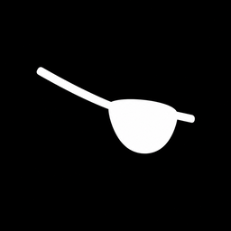

<p align="center">
  
</p>

<h1 align="center">unskilled browser</h1>

<p align="center">
  A private Chromium browser with a hand-built Rust interface.<br>
  Ad and tracker blocking built in · encrypted profile behind a PIN · history wiped on close · nothing phones home.
</p>

<p align="center">
  <a href="https://github.com/itsArial/unskilled-browser/actions/workflows/ci.yml"></a>
  <a href="https://github.com/itsArial/unskilled-browser/releases"></a>
  <a href="LICENSE"></a>
</p>

---

unskilled renders the web with Chromium (through the [Chromium Embedded Framework](https://bitbucket.org/chromiumembedded/cef)).
The interface around it is drawn from scratch: a small GPU renderer, spring physics and a JetBrains Mono glyph atlas, with no UI toolkit.
Pages reach the screen without a CPU copy, as DMA-BUFs on Linux and as D3D11 shared textures on Windows.

> **Status: early (0.x).** The browser is in daily use on Linux. The Windows build compiles in CI but has had little real-world testing. See [platform support](#platform-support).

## Features

**Blocking**
- A built-in blocker at the level of uBlock Origin. It runs the uBO filter lists, scriptlets and redirect resources on [adblock-rust](https://github.com/brave/adblock-rust), with cosmetic filtering and URL tracking-parameter removal.
- YouTube works with no ads and no "ad blockers are not allowed" wall: uBO's YouTube and anti-adblock rules apply before page scripts run.
- Cookie-consent banners and walls are removed rather than clicked through. Under GDPR, no answer means no consent.
- The extensions panel lets you pause the blocker, add a site exception, and see a live log of every blocked tracker attempt with details.

**Privacy**
- **Every site in its own sandbox.** Each site gets its own cookie jar, storage, cache and connections, not just partitioned third-party storage.
  - Sites can't see each other's data, even first-party cookies set while you were bounced through a tracker.
  - A provider's own sites (google.com, youtube.com, gmail.com…) share one sandbox, so they keep working together.
  - "Forget" erases a single site.
- **Encrypted vault.** The profile (logins, site storage, bookmarks, passwords) is encrypted at rest with XChaCha20-Poly1305. Every launch asks for a PIN.
  - On Linux the key is sealed in the TPM 2.0, so the vault file is useless on any other machine and the TPM locks after repeated wrong PINs.
  - Without a TPM, the key comes from a passphrase via argon2id (256 MB).
- **Nothing survives a session except what you chose.** History, cache and every other trace are dropped on close. Only logins, site storage and your own data are kept.
- **No phoning home.** Component updates, variations, crash reports, safe-browsing pings, sync, Privacy Sandbox and FedCM are all off. WebRTC only ever uses the default route.
- **Sign-in gate.** When a site sends you to "Sign in with Google / Apple / Microsoft / Facebook / GitHub / Discord / X / LinkedIn", the browser asks first.
  - Until you allow it, the sign-in runs in that site's own sandbox, where the provider sees you signed out, so the site can't tell you have an account there.
  - Allowing it copies just that sign-in into the site's sandbox.
- Third-party cookies are blocked by default.

**Everyday**
- A **password manager** written for this browser. Passwords live inside the vault and are never synced.
  - Every fill, show or copy asks for your vault PIN; you can turn that off in settings.
  - Import from Google Password Manager, Chrome or Firefox (.csv).
- **Bookmarks:** ctrl+d, a bookmarks page, tiles on the start page, and import from any browser's .html export.
- **Settings** at `unskilled://settings`: search engine (DuckDuckGo, Mullvad Leta, Brave Search, Startpage), sign-in decisions, passwords, vault.
- **Chrome extensions** at `unskilled://extensions`:
  - add from a .crx or .zip file, or paste a Chrome Web Store link;
  - enable, disable or remove;
  - packages are unpacked by the browser's own CRX/ZIP code;
  - every site's sandbox runs its own copy, so extension data is separated per site too.
- **Mullvad status** in the bar, read from the local Mullvad app.

**Developers**
- Full **Chrome DevTools**, docked next to the page (F12).
- A **site inspector** (ctrl+shift+d) showing:
  - the resolved IP, ISP/ASN and whether the site sits behind Cloudflare or another CDN or is reached directly;
  - TLS and protocol details;
  - every host the page talked to;
  - every tracker that was blocked.

## Install

### Linux (x86_64)

Download `unskilled-browser-<version>-linux-x86_64.tar.gz` from [Releases](https://github.com/itsArial/unskilled-browser/releases), unpack it anywhere, and run `./unskilled`.

**Requirements**
- A Vulkan driver (Mesa or NVIDIA).
- XWayland when running under Wayland. Chromium uses it only to allocate GPU buffers; no X window is opened.
- For the short TPM PIN, access to `/dev/tpmrm0`: run `sudo usermod -aG tss $USER` and log in again. Without it the vault uses a passphrase. You're offered the switch to a PIN once the TPM becomes usable.

To install from source as a desktop app (launcher entry, icon, in-place updates):

```sh
git clone https://github.com/itsArial/unskilled-browser
cd unskilled-browser
scripts/install.sh
```

### Windows (x86_64, experimental)

Download `unskilled-browser-<version>-windows-x86_64.zip`, unpack it, and run `unskilled.exe`. Windows 10 or 11 with a Direct3D 12 GPU is required.

## Build from source

The build downloads the CEF binary distribution (about 1 GB unpacked) automatically.

**Linux**
- Rust 1.89 or newer.
- `cmake`, `ninja`, `pkg-config`, and tpm2-tss development files:
  - Arch: `pacman -S cmake ninja tpm2-tss`
  - Debian/Ubuntu: `apt install cmake ninja-build pkg-config libtss2-dev libwayland-dev libxkbcommon-dev`

```sh
scripts/run.sh            # debug build, runs from the source tree
scripts/run.sh --release
scripts/package.sh        # portable bundle in dist/
```

**Windows**
- Rust (MSVC toolchain), Visual Studio 2022 Build Tools (C++), `cmake` and `ninja`.
- From a *Developer PowerShell*: `cargo build --release`.
- To build the bundle, run `bash scripts/package.sh` from Git Bash.

## Platform support

| | Linux | Windows |
|---|---|---|
| Zero-copy page rendering | ✅ DMA-BUF → Vulkan | ✅ D3D11 → D3D12 |
| Vault encryption at rest | ✅ | ✅ |
| TPM-sealed PIN | ✅ TPM 2.0 | ❌ passphrase only |
| Open session kept in RAM only | ✅ `$XDG_RUNTIME_DIR` (tmpfs) | ❌ on disk under `%LOCALAPPDATA%` while running, erased on close |
| Chromium sandbox | ✅ | ⚠️ not yet (needs CEF's `bootstrap.exe` launcher) |
| Clean save on logout/shutdown | ✅ SIGTERM handled | ⚠️ window close only |

## Roadmap

Planned work ([docs/PLAN.md](docs/PLAN.md) has the full design):
- Profiles.
- Browser personas (fingerprint shaping).
- In-browser Mullvad exits per sandbox, and a kill switch.
- Extension toolbar buttons and popups.
- A Wireshark-style traffic panel with pcapng export.
- A privacy-patched Chromium build.

## Architecture

| crate | what it does |
|---|---|
| `crates/shell` | the app: window, browser chrome, prompts, lock screen |
| `crates/ui` | GPU renderer (wgpu), springs, text (swash + JetBrains Mono) |
| `crates/engine` | CEF integration: windowless pages, input, network interception, internal pages, DevTools bridge |
| `crates/shield` | the blocker: filter lists, scriptlets, cosmetic filtering |
| `crates/vault` | encrypted profile storage, TPM sealing, session lifecycle |
| `crates/profile` | bookmarks, passwords, sign-in decisions, preferences |
| `crates/netinfo` | offline IP → ASN lookups and CDN classification for the inspector |

## Security

Please report vulnerabilities privately. See [SECURITY.md](SECURITY.md).

## License

unskilled browser is free software under the [GNU General Public License v3.0 or later](LICENSE).
It embeds uBlock Origin's scriptlets and resources (GPL-3.0), and ships Chromium and CEF under their own licenses.
See [THIRD_PARTY_NOTICES.md](THIRD_PARTY_NOTICES.md).

unskilled browser is not affiliated with Google, Mullvad, Nothing or the uBlock Origin project.
